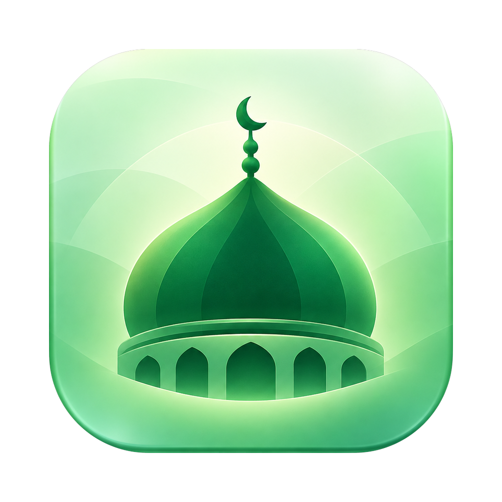
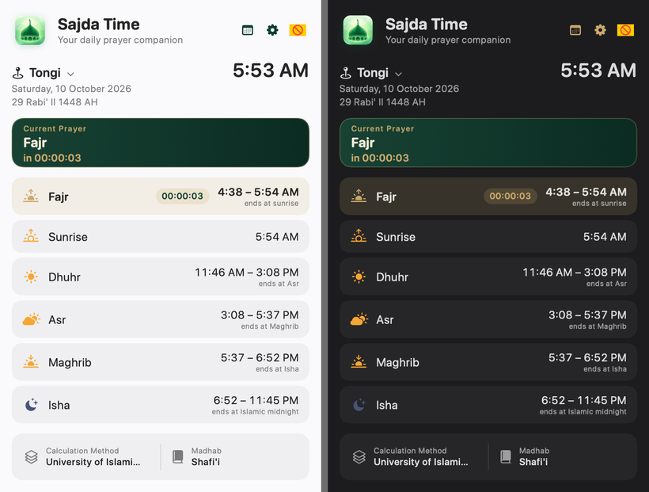
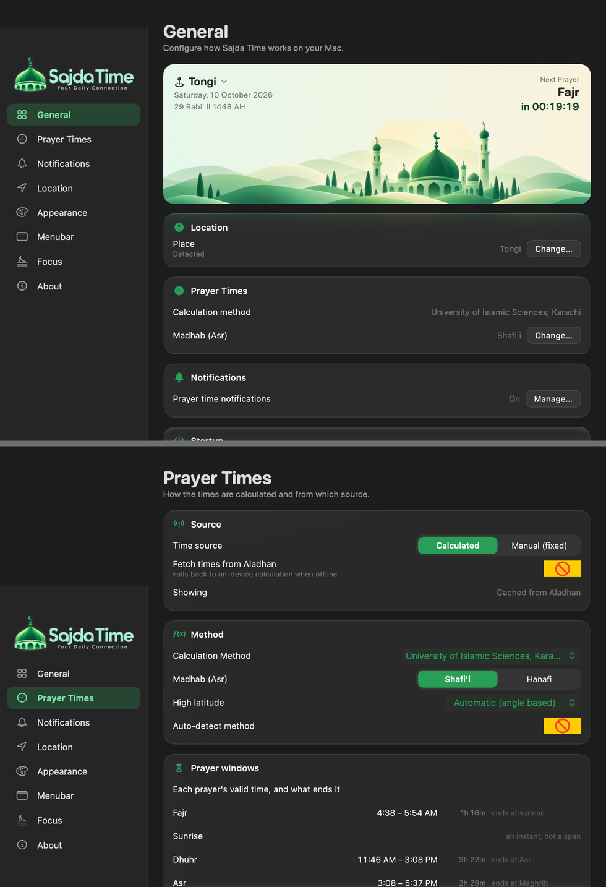

<div align="center">



# Sajda Time

**A native macOS menu bar app for prayer times — accurate, offline-capable, and built on Liquid Glass.**

[](https://www.apple.com/macos/)
[](https://swift.org)
[](#building)
[](#accuracy)


</div>

Sajda Time lives in your menu bar and shows how long is left in the current
prayer window. When a prayer begins it covers the screen with a short reminder —
the time, a hadith on the merit of salah, and a backdrop chosen to match the
light of that hour.

---

## Features

**Prayer times you can check.** Live times from the [Aladhan API](https://aladhan.com/prayer-times-api),
cached per day, with an on-device astronomical calculator as the offline
fallback. 22 calculation methods and both Asr madhabs, validated against Aladhan
to a mean difference of **0.15 minutes** ([details](#accuracy)).

**Prayer *windows*, not just start times.** Fajr runs until sunrise, Dhuhr until
Asr, Asr until Maghrib, Maghrib until Isha, and Isha until Islamic midnight —
with the time of necessity after that. The menu bar counts down the window you
are actually in.

**A full-screen reminder at prayer time.** Covers every display, with a backdrop
matched to the prayer — first light for Fajr, bright midday for Dhuhr, golden
hour for Asr, sun on the horizon for Maghrib, night for Isha. One large Dismiss
button, plus Snooze and Mute-Adhan-Today. A short, referenced hadith each time.

**Accurate location and timezone.** Detects your position, resolves the place
name, picks the calculation method for your region, and keeps the Hijri date
adjustable for local moon sighting.

**Focus Mode.** Optionally covers the screen for a set period at prayer time, as
a discipline aid rather than a lock.

**Quietly native.** A menu bar app with no Dock icon, following your system
appearance, in 12- or 24-hour time.

## Screenshots

<div align="center">



<sub>The menu bar panel, following the system appearance.</sub>



<sub>Settings: a summary dashboard, and the prayer-time controls.</sub>

</div>

## Requirements

- **macOS 26 or later** — the interface is built on Liquid Glass
  (`.glassEffect`, `GlassEffectContainer`), which earlier releases do not have.
- **Apple silicon.** The build targets `arm64-apple-macosx26.0`.
- Xcode command line tools for `swiftc`, `xcrun`, `sips` and `iconutil`.
  Tested with Xcode 27 / Swift 6.4.

## Building

No package dependencies, so nothing is fetched at build time.

```bash
git clone git@github.com:rony747/SajdaTime.git
cd SajdaTime
./build.sh                 # release, the default; ./build.sh debug for -Onone -g
```

```
==> Building SajdaCore (release)
==> Building sajdactl
==> Building SajdaTime app binary
==> Assembling app bundle
    version: 2.9.0 (build 23)
    icon: AppIcon.icns generated
    signed (ad-hoc)

  CLI : .build/bin/sajdactl
  App : dist/Sajda Time.app
```

A clean release build takes about 25 seconds. To install it:

```bash
rm -rf "/Applications/Sajda Time.app"
cp -R "dist/Sajda Time.app" /Applications/
open "/Applications/Sajda Time.app"
```

The app appears in the menu bar, not the Dock.

> **On `swift build`.** `Package.swift` is maintained and the project opens
> normally in Xcode, but the build script calls `swiftc` directly. SwiftPM's
> build systems cannot write their state files in a restricted environment, and
> `swiftc` normally wraps macro plugin servers in `sandbox-exec`, which cannot
> nest. `build.sh` passes `-disable-sandbox` and manages the module cache itself.
> See [engineering notes](docs/ENGINEERING.md).

The result is **ad-hoc signed** and runs locally. It is not signed with a
Developer ID and not notarised, so distributing it to other machines needs your
own signing certificate.

## Accuracy

Every calculation method was checked against live Aladhan results across a grid
of cities, dates and latitudes:

| | |
| --- | --- |
| Mean absolute difference | **0.15 min** |
| Within 1 minute | **130 of 132** comparisons |
| Worst case | 2 minutes |

High-latitude handling follows Aladhan's angle-based rule so the two agree in
polar summer. The one place they diverge is **Asr at extreme latitudes**
(Svalbard), where the shadow ratio is very sensitive and the difference can reach
about 20 minutes.

## How it works

- **`SajdaCore`** — a dependency-free library: solar position (Meeus/NOAA),
  prayer calculation for all 22 methods, the Aladhan client, caching, settings,
  Qibla, Hijri conversion, and a self-test covering the engine invariants.
- **`SajdaTimeApp`** — the AppKit + SwiftUI app: an `NSStatusItem` and
  `NSPopover` for the panel, a full-screen reminder window per display, and the
  settings window.
- **`sajdactl`** — a verification CLI, because a menu bar app is awkward to test
  by hand. It runs `selftest`, compares the engine against Aladhan (`compare`,
  `matrix`), prints the method table, and reads the store.

```
Sources/
  SajdaCore/         prayer times, astronomy, settings  (no UI, no dependencies)
  SajdaTimeApp/      menu bar app, panel, reminder, settings
  SajdaTimeCtl/      sajdactl verification CLI
Resources/
  Assets/            icon, wordmark, banner, reminder backdrops
docs/
  ENGINEERING.md     design decisions and implementation notes
```

## Development

The app has environment-gated hooks so it can be exercised without a screen —
useful because the UI is a popover and full-screen windows:

```bash
SAJDA_RENDER=/tmp/out       # render every surface to PNG
SAJDA_TEST_ALERT=isha       # show the full-screen reminder immediately
SAJDA_DEBUG=1               # log popover geometry, appearance, window key status
SAJDA_FAKE_HEADING=90       # pretend a magnetometer exists
SAJDA_OPEN_SETTINGS=1       # open the settings window on launch
```

```bash
./.build/bin/sajdactl selftest    # engine invariants
./.build/bin/sajdactl compare     # this engine vs live Aladhan
./.build/bin/sajdactl methods     # every method with its parameters
```

Full list in the [engineering notes](docs/ENGINEERING.md).

## Known limitations

- **Asr at extreme latitudes** can differ from Aladhan by ~20 minutes.
- **Qibla is hidden unless the machine has a magnetometer.** Macs do not, so on a
  Mac the compass is absent rather than pointing at nothing.
- **Ad-hoc signed**, so it is not distributable as-is.
- **English only.** There is no localisation, and no setting pretending otherwise.
- Times come from the **Aladhan API**; if it is unreachable the app falls back to
  its own calculation and says so in the UI.

## Documentation

- [Engineering notes](docs/ENGINEERING.md) — design decisions, Liquid Glass
  guidance, typography, settings layout, and the reasoning behind each surface.

## License

No licence has been chosen yet, so this repository is **all rights reserved** by
default. If you intend others to use it, add one — MIT and Apache-2.0 are the
usual choices for a project like this.
